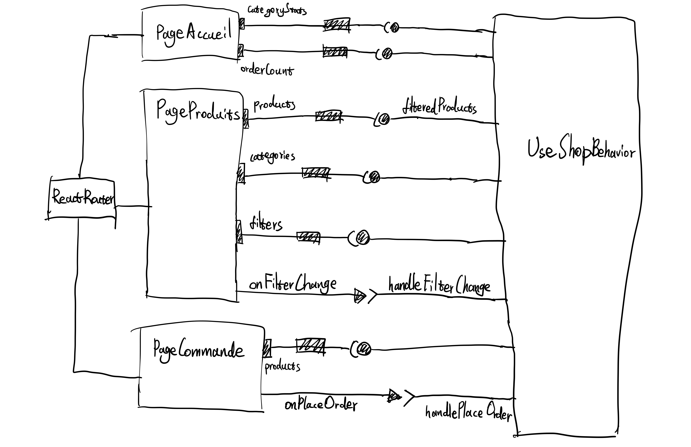
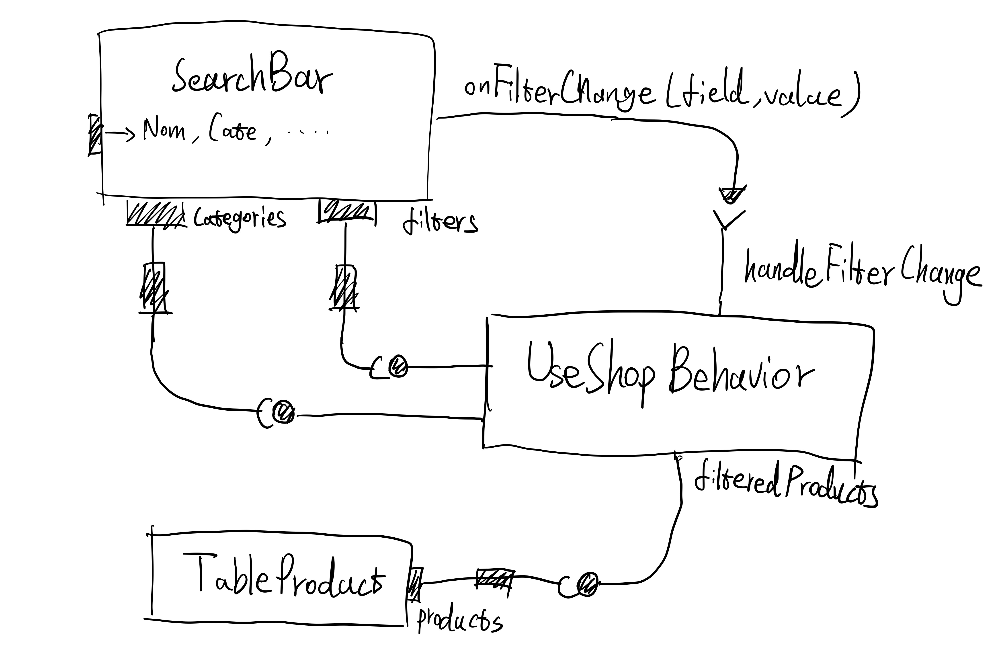
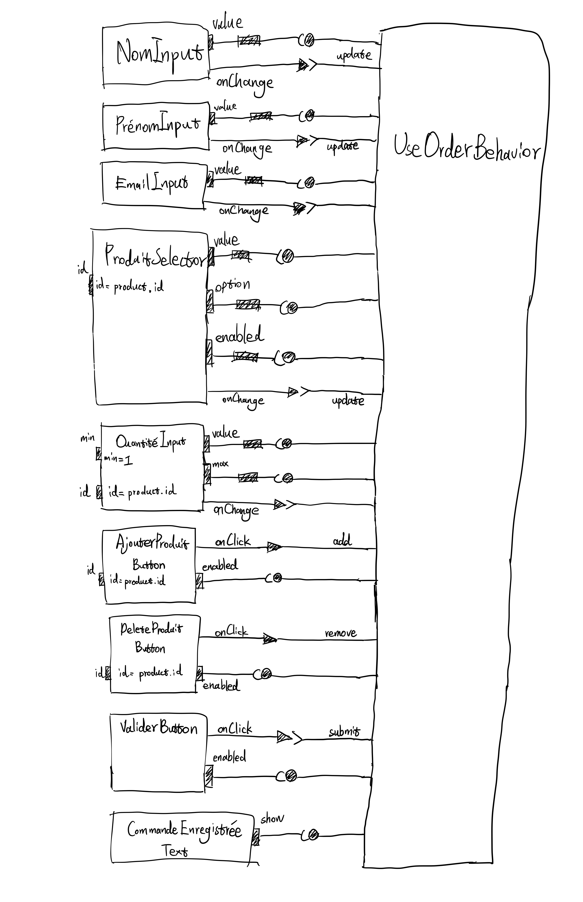

# Mini Projet : Site commercial (React)

## Partie 1 : Diagrammes de composants

### Figure 1 : vue d'ensemble de l'application



Dans `App`, on appelle une seule fois `useShopController`, puis on transmet le résultat aux trois pages par les props. React Router choisit la page à afficher selon le chemin (`/`, `/products`, `/orders`). Les trois pages utilisent les mêmes données : quand on passe une commande sur la page Commande, le nombre de commandes de l'accueil et le stock de la page Produits sont mis à jour.

### Figure 2 : page Produits



La SearchBar contient 7 champs de saisie et 1 liste déroulante, ce qui permet de filtrer sur tous les attributs. À chaque modification, elle prévient le Hook avec `onFilterChange(field, value)`. TableProduct reçoit les produits filtrés.

### Figure 3 : page Commande



Pour la page Commande, on a dessiné chaque contrôle séparément. Le `min = 1` du champ quantité est une constante écrite en dur, donc on a seulement dessiné l'attribut, sans connexion. Le `max` vient du stock du produit sélectionné et doit être récupéré depuis le Hook : c'est comme ça qu'on respecte la contrainte « ne pas dépasser la quantité disponible ».

## Partie 2 : Analyse des design patterns

| Pattern | Cas | Complet | Emplacement |
|---|---|---|---|
| MVC | Présence | Oui | `model/`, `controller/`, `pages/`, `components/` et `App.jsx` |
| Singleton | Présence | Oui | `model/ShopStore.js` |
| Abstract Factory | Compatibilité, non implémenté | — | — |
| Builder | Présence | Non | `model/OrderBuilder.js`, `model/orderModel.js` |
| Decorator | Présence | Oui | `model/orderValidators.js`, `model/orderModel.js` |
| Command | Présence | Non | `controller/PlaceOrderCommand.js`, `controller/useShopController.js` |
| Observer | Présence | Oui | `model/ObservableSubject.js` (utilisé par `ShopStore` et `OrderSubmission`) |
| State | Présence | Oui | `controller/OrderSubmission.js`, `controller/useOrderController.js` |

### MVC

- Model : `ShopStore`, `productModel`, `orderModel` (ainsi que `OrderBuilder`, `orderValidators`, `ObservableSubject` et le fichier de données `products.json`, utilisés à l'intérieur) ;
- View : les pages et les composants d'affichage, `App` assemble les routes et les pages ;
- Controller : les deux Hooks, qui gardent les filtres et le contenu du formulaire, et qui appellent le Model (les classes `PlaceOrderCommand` et `OrderSubmission` de `controller/` sont appelées par ces Hooks, voir Command et State).

Par exemple : on tape dans la SearchBar → `handleFilterChange` met à jour `filters` → `filterProducts(products, filters)` calcule le résultat → le tableau se réaffiche.

Il y a deux endroits pas tout à fait « standard » : `RowProduct` importe directement `isLowStock` depuis le Model, et le message d'erreur `getOrderErrorMessage` est écrit dans `OrdersPage`. En théorie, ces deux parties devraient être dans le Controller.

### Singleton

Il n'y a qu'un seul `ShopStore` dans toute l'application, donc les trois pages voient le même stock. Le constructeur demande une clé interne au module : un `new ShopStore()` fait depuis l'extérieur lève une erreur, il faut passer par `getInstance()` :

```js
static getInstance() {
  if (!ShopStore.#instance) {
    ShopStore.#instance = new ShopStore(constructorKey)
  }
  return ShopStore.#instance
}
```

### Abstract Factory (compatible, non implémenté)

Le projet n'a qu'un seul type de commande, donc il n'y a pas de « famille d'objets » à interchanger. Si plus tard on voulait distinguer les commandes de particuliers et d'entreprises, chacune avec ses propres validateurs et son propre Builder, on pourrait ajouter une `OrderFactory` (`createValidator()`, `createBuilder()`) et l'implémenter dans `PersonalOrderFactory` et `BusinessOrderFactory`. Pour l'instant, ça ajouterait juste des classes en plus, donc on ne l'a pas fait.

### Builder

`placeOrder` utilise d'abord `withCustomer()` pour les informations du client, puis `addItem()` pour ajouter les produits ligne par ligne, et enfin `build()` vérifie que la commande est complète. On le considère comme une version simplifiée, parce qu'il n'y a pas d'interface Builder abstraite et que c'est la fonction `placeOrder` qui joue aussi le rôle du Director. Honnêtement, dans ce projet le Builder n'apporte pas grand-chose : la structure d'une commande est déjà assez simple.

### Decorator

`OrderItemsValidator` fait les vérifications de base, et les trois autres règles sont des décorateurs avec la même interface `validate(products, draft)`, qu'on emboîte les uns dans les autres :

```js
const itemsValidator = new StockValidationDecorator(
  new UniqueProductsDecorator(new OrderItemsValidator()),
)
const orderValidator = new CustomerValidationDecorator(itemsValidator)
```

L'ordre des vérifications est : informations du client → vérifications de base des lignes → produits en double → stock. On s'arrête à la première erreur. Pour ajouter une nouvelle règle, il suffit d'ajouter une couche.

### Command

L'action de passer une commande est encapsulée dans `PlaceOrderCommand`, et `execute()` la délègue à `ShopStore.placeOrder()` :

```js
const handlePlaceOrder = (draft) => new PlaceOrderCommand(shopStore, draft).execute()
```

Ce qui manque : la commande est exécutée dès sa création, il n'y a ni Invoker séparé ni historique, donc on ne peut pas annuler. Pour le compléter, on pourrait ajouter une méthode `undo()` qui remet le stock, et garder dans le Controller une liste des commandes déjà exécutées.

### Observer

`ObservableSubject` propose trois choses : `subscribe()`, le désabonnement et `update()`. Quand les données changent, `update()` prévient tous les abonnés. Côté React, on s'abonne avec `useSyncExternalStore(shopStore.subscribe, shopStore.getSnapshot)`, donc les pages se mettent à jour toutes seules après une commande réussie. `OrderSubmission` utilise la même classe pour prévenir la page Commande quand l'état de l'envoi change.

### State

L'envoi d'une commande a trois états : en cours d'édition, refusée, acceptée. Le même `submit()` ne fait pas la même chose selon l'état : en édition ou après un refus, la commande est vraiment passée ; une fois acceptée, il renvoie juste le résultat précédent, sans repasser la commande :

```js
class AcceptedOrderState extends OrderSubmissionState {
  // ...
  submit() {
    return this.#result
  }
}
```

Dès qu'on modifie un champ, `edit()` est appelé et on revient à l'état d'édition, ce qui fait aussi disparaître le message d'erreur.

### Comment ces patterns travaillent ensemble lors d'une commande

1. Quand on clique sur « Valider la commande », `useOrderController` prépare le brouillon de la commande (State : `submit`).
2. `handlePlaceOrder` est appelé : il crée et exécute une `PlaceOrderCommand` (Command).
3. La commande appelle l'unique `ShopStore` (Singleton), qui appelle à son tour `orderModel.placeOrder()`.
4. La chaîne de validateurs vérifie la commande (Decorator), puis `OrderBuilder` construit la commande (Builder).
5. `ShopStore` publie le nouveau stock et la nouvelle liste de commandes, et les pages se mettent à jour (Observer).
6. Le résultat revient à `OrderSubmission`, et la page Commande affiche la confirmation ou l'erreur (State + Observer).

## Remarques

- Les données sont seulement en mémoire : si on recharge la page, on revient aux données de départ de `products.json`. On avait fait une version qui sauvegardait le stock dans le localStorage, avec un bouton pour réinitialiser le stock, mais on ne l'a pas gardée.
- La page d'accueil affiche seulement le nombre de commandes, il n'y a pas de page qui liste les commandes ; le sujet demande seulement le nombre.
